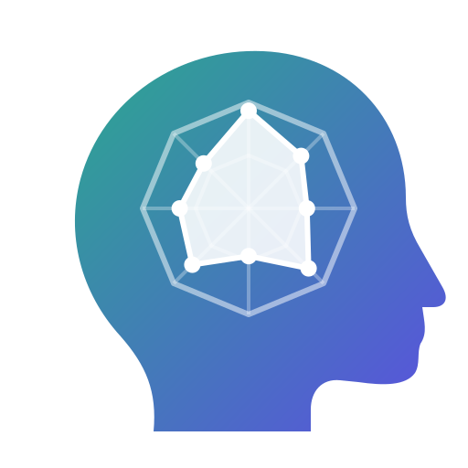

<p align="center"></p>

<h1 align="center">MindScope</h1>

<p align="center">
  免费 · 开源 · 离线的人格与心理状态自评工具<br>
  Free, open-source, offline personality &amp; wellbeing self-assessment
</p>

<p align="center">
  <a href="LICENSE"></a>
  <a href="LICENSE-MIT"></a>
  
  
</p>

<p align="center"><a href="#中文">中文</a> · <a href="#english">English</a></p>

<p align="center"></p>

---

## 中文

> **当前版本 0.7.0**：开发计划中的 Phase 0–6 已完成，并新增大五人格先行版；正式版 1.0.0 即将发布。详见 [开发进度](docs/PROGRESS.md) 与 [更新记录](CHANGELOG.md)。

### 为什么做 MindScope

市面上的 MBTI 测试大多收费、不透明，还会收集你的数据。MindScope 想做一个**每个人都能信任**的版本：

- **白盒**：评分公式、题库、选题逻辑全部公开，同样的答案永远得到同样的结果。
- **免费开源**：任何人都可以检查、使用和改进。
- **离线优先**：默认不联网，数据只保存在你自己的电脑或浏览器里。
- **不是诊断工具**：人格结果用于自我了解；心理状态自评只是自我筛查。

### 功能

- **人物卡**：为自己和家人朋友分别建卡，可加标签和头像；显示测评次数、最近类型、性格描述、**最佳相处方式**和变化趋势。
- **16 型人格测评**：快速 40 题 / 普通 80 题 / 资深 144 题 / 全域 216 题；自适应选题、进度矩阵、标记题目、暂停续答；结果包括四个维度和**八功能八边形雷达图**，并写明计算方法和局限。
- **大五人格（先行版）**：快速 20 题（Mini-IPIP）/ 普通 50 题（IPIP 大五标记）/ 资深 120 题（IPIP-NEO-120，含 30 个子维度）；题目来自公有领域的国际人格题库 IPIP，中文由 MindScope 翻译（尚未验证，无常模）。
- **心理状态自评**：PHQ-9（抑郁症状）、GAD-7（焦虑症状）、WHO-5（主观幸福感）、自编压力自评；按官方分级解读，PHQ-9 第 9 题触发时显示求助资源。
- **历史与对比**：按人物 / 模式 / 日期筛选，同一人多次或多人之间对比。
- **正式 PDF 报告**：A4 版式，带页码，可选择包含的内容。
- **成长记录**与**可选的 AI 分析**（默认关闭，使用你自己的 API Key，每次发送前确认；仅桌面版）。
- **数据管理**：数据文件夹查看、备份与恢复、迁移、日志与缓存清理、网络请求记录。

### 下载与运行

| 版本 | 使用方法 | 数据保存在 |
|---|---|---|
| **Windows 便携版** `MindScope-<版本>-win-x64-portable.zip` | 解压到任意可写的文件夹（如 `D:\MindScope` 或 U 盘），双击 `MindScope.exe`。无需安装，删除文件夹即卸载 | exe 旁边的 `data\`、`logs\`、`cache\`、`config\`；**不写 C 盘用户目录、不写注册表** |
| **网页版** `MindScope-<版本>-web.zip` | 解压后放到任意静态网站空间（支持子路径，需要 HTTPS），见包内 `DEPLOY.txt` | 每位访问者自己的浏览器 |

系统要求：Windows 10 / 11（64 位）。界面依赖 Microsoft Edge WebView2 运行时（Windows 11 自带；缺失时程序会提示）。网页版需要较新的 Chrome / Edge / Firefox / Safari。发布包可在 Releases 页面下载，并附 SHA256 校验值。

👉 详细操作见 **[用户使用说明](docs/用户使用说明.md)**。

### 隐私

- 默认**不发起任何网络请求**；桌面版和网页版都用严格的内容安全策略禁止访问外部地址，发布测试会监视程序及其 WebView2 进程的全部网络连接。
- 唯一会联网的是你主动开启的 AI 分析和"在浏览器中打开链接"，都会先征得同意；AI 请求记录在「数据与存储 → 网络」中（不记录内容和 Key）。
- 姓名、备注、头像和逐题答案从不发送给 AI；API Key 用 Windows DPAPI 加密保存在软件文件夹中。

### 开发

需要 Node.js ≥ 22.12、Rust（MSVC 工具链）和 WebView2 运行时。

```bash
npm install
npm run dev:web            # 网页版 http://localhost:5173
npm run dev:desktop        # 桌面版（Tauri）
npm test                   # 单元测试
npm run test:e2e           # 网页端 E2E
npm run package:portable   # 便携版 zip + release/MindScope/
npm run package:web        # 网页版 zip
npm run test:release       # 桌面发布测试
```

架构、数据模型、评分方法、如何添加题库或量表，见 **[开发者文档](docs/开发者文档.md)**。

### 许可证

| 部分 | 许可证 |
|---|---|
| 应用整体（`apps/`） | [AGPL-3.0-or-later](LICENSE) |
| 评分引擎 `packages/core`、存储层 `packages/storage` | [MIT](LICENSE-MIT) |
| 自编题库、文案、Logo | CC BY-SA 4.0 |
| 大五人格题目 | IPIP，公有领域（中文译文 CC BY-SA 4.0） |
| PHQ-9、GAD-7 | 公有领域 |
| WHO-5 | © WHO 2024，CC BY-NC-SA 3.0 IGO（仅限非商业使用） |

详见 [NOTICE.md](NOTICE.md)。MBTI 是 The Myers-Briggs Company 的注册商标；MindScope 与其无关，提供的不是官方 MBTI 量表。

**MindScope 不是医疗器械，不能用于诊断。** 如果你感到难以应对，请联系专业人员；在中国大陆可拨打全国统一心理援助热线 **12356**，紧急情况请拨打 **110 / 120**。

---

## English

> **Current version 0.7.0**: Phases 0–6 of the development plan are complete, plus a Big Five preview; the 1.0.0 release is coming. See the [progress tracker](docs/PROGRESS.md) and [changelog](CHANGELOG.md) (in Chinese).

### Why MindScope

Most MBTI-style tests online are paid, opaque, and collect your data. MindScope aims to be one that **everyone can trust**:

- **White-box**: scoring formulas, item banks and item selection are all public; the same answers always give the same result.
- **Free and open source**: anyone can inspect, use and improve it.
- **Offline-first**: no network access by default; your data stays on your own computer or in your own browser.
- **Not a diagnostic tool**: personality results are for self-understanding; wellbeing checks are self-screening only.

### Features

- **Person cards**: one card per person (yourself, family, friends) with tags and avatars, showing test count, latest type, description, **how to get along** and trends over time.
- **16-type personality test**: quick 40 / normal 80 / senior 144 / full 216 items; adaptive item selection, progress grid, flagging, pause and resume; results include four dimensions and an **eight-function octagon radar**, with the method and limitations spelled out.
- **Big Five (preview)**: quick 20 (Mini-IPIP) / normal 50 (IPIP Big-Five markers) / senior 120 (IPIP-NEO-120 with 30 facets); public-domain items from the International Personality Item Pool, Chinese translation by MindScope (not yet validated, no norms).
- **Wellbeing self-checks**: PHQ-9 (depressive symptoms), GAD-7 (anxiety symptoms), WHO-5 (wellbeing) and a self-written stress check; official cut-offs, and crisis resources whenever PHQ-9 item 9 is endorsed.
- **History and comparison**: filter by person / mode / date; compare results of one person over time or of different people.
- **Formal PDF reports**: A4 layout with page numbers and selectable sections.
- **Growth notes** and **optional AI analysis** (off by default, your own API key, confirmation with a full preview before every request; desktop only).
- **Data management**: data folders, backup and restore, relocation, log and cache cleanup, network request log.

### Download and run

| Edition | How to use | Where data is stored |
|---|---|---|
| **Windows portable** `MindScope-<version>-win-x64-portable.zip` | Unzip to any writable folder (e.g. `D:\MindScope` or a USB stick) and run `MindScope.exe`. No installation; delete the folder to uninstall | `data\`, `logs\`, `cache\`, `config\` next to the exe — **nothing in your user profile on C:, nothing in the registry** |
| **Web** `MindScope-<version>-web.zip` | Unzip to any static web host (sub-paths work, HTTPS required); see `DEPLOY.txt` in the package | Each visitor's own browser |

Requirements: Windows 10 / 11 (64-bit) with the Microsoft Edge WebView2 Runtime (built into Windows 11; the app tells you if it is missing). The web edition needs a recent Chrome, Edge, Firefox or Safari. Packages are on the Releases page with SHA256 checksums.

The **[user guide](docs/用户使用说明.md)** and **[developer guide](docs/开发者文档.md)** are currently in Chinese. The interface is available in Chinese and English.

### Privacy

- **No network requests by default.** Both editions use a strict Content-Security-Policy that blocks outside addresses; the release tests watch every network connection of the app and its WebView2 processes.
- The only features that go online are the AI analysis you turn on yourself and "open link in browser", and both ask first. AI requests are listed under Data and storage → Network (without content or key).
- Names, notes, avatars and item answers are never sent to an AI; the API key is encrypted with Windows DPAPI in the app folder.

### Development

Requires Node.js ≥ 22.12, Rust (MSVC toolchain) and the WebView2 Runtime.

```bash
npm install
npm run dev:web            # web edition at http://localhost:5173
npm run dev:desktop        # desktop edition (Tauri)
npm test                   # unit tests
npm run test:e2e           # web end-to-end tests
npm run package:portable   # portable zip + release/MindScope/
npm run package:web        # web zip
npm run test:release       # desktop release tests
```

Tech stack: Tauri 2 (Rust) + WebView2, Vue 3 + TypeScript, SQLite on both editions (sqlite-wasm with OPFS in the browser, rusqlite on desktop), ECharts, Vitest and Playwright.

### License

| Part | License |
|---|---|
| The application (`apps/`) | [AGPL-3.0-or-later](LICENSE) |
| Scoring engine `packages/core`, storage layer `packages/storage` | [MIT](LICENSE-MIT) |
| Self-written item banks, texts, logo | CC BY-SA 4.0 |
| Big Five items | IPIP, public domain (Chinese translation CC BY-SA 4.0) |
| PHQ-9, GAD-7 | Public domain |
| WHO-5 | © WHO 2024, CC BY-NC-SA 3.0 IGO (non-commercial use only) |

See [NOTICE.md](NOTICE.md) for details. MBTI is a registered trademark of The Myers-Briggs Company; MindScope is not affiliated with it and is not the official MBTI instrument.

**MindScope is not a medical device and cannot be used for diagnosis.** If you are struggling, please reach out to a professional or your local emergency number.
