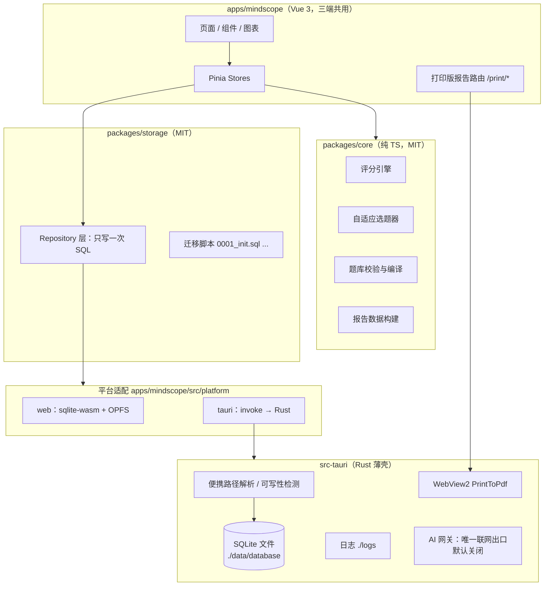
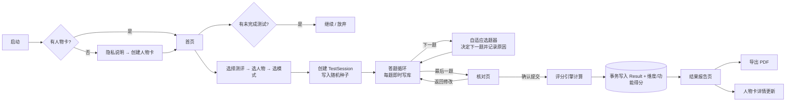
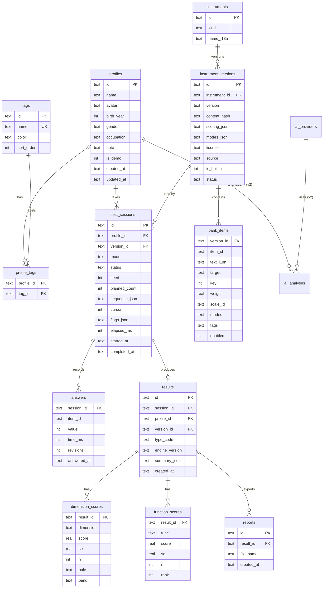

# MindScope — Phase 0 技术方案

> 状态：**关键决策已确认**（见第 13 节），等待开始 Phase 1
> 日期：2026-10-22
> 范围：需求梳理、技术选型、架构、数据模型、评分引擎、题库格式、离线数据管理、候选数据集、风险、开发计划

---

## 0. 结论摘要（一页读完）

| 决策点 | 建议 | 一句话理由 |
|---|---|---|
| 桌面框架 | **Tauri 2（Rust 薄壳）+ WebView2** | 产物是单个约 10 MB 的 exe，满足"压缩包里只有 exe + LICENSE"；同一套代码以后能出 Android |
| 前端 | **Vue 3 + TypeScript + Vite + Pinia + vue-i18n** | 你熟悉 Vue；网页端、桌面端、手机端共用同一套 UI |
| 核心逻辑 | **纯 TypeScript 包 `@mindscope/core`** | 评分、自适应选题、报告数据全部在这里，三端共用、可单测、白盒 |
| 数据库 | **SQLite**：桌面用 Rust `rusqlite` 读写 `./data/database/mindscope.db`；网页端用官方 `sqlite-wasm`（OPFS 持久化） | 两端同一套表结构和 SQL，迁移脚本只写一份 |
| 图表 | **ECharts**（本地打包、SVG 渲染） | 八边形雷达、趋势线、柱状图都原生支持，打印到 PDF 清晰 |
| PDF | 桌面：WebView2 原生 `PrintToPdf`；网页：浏览器打印→另存为 PDF；兜底：jsPDF 栅格化 | 中文直接用系统字体，不用打包 10 MB+ 的中文字体 |
| 联网 | **默认零联网**：CSP 禁止一切外部请求；唯一出口是 AI 网关（Rust 侧），每次发送前弹窗确认并展示要发送的数据 | 可审计的"绝不联网" |
| AI（第二版） | Rust 侧 OpenAI 兼容客户端 → 百炼 DashScope `compatible-mode`；用户自填 API Key，Windows DPAPI 加密保存 | LangChain4j 是 Java 生态，本栈用等价的轻量 Prompt 模板层即可 |
| MBTI 题库 | **自编题库**（中英双语，约 216 题，标注"自编、未经常模验证"） | Kaggle 上没有可合法再分发的 MBTI 题目（见第 9 节） |
| 心理状态首批量表 | **PHQ-9 + GAD-7 + WHO-5 + 自编压力自评（非标准化）** | DASS 明确禁止在面向公众的 App 中向答题者展示分数，不能用 |
| 许可证 | 核心库 MIT + 应用 AGPL-3.0 + 题库/文案 CC BY-SA 4.0（已确认） | 见 1.3 |

---

## 1. 需求清单与冲突说明

### 1.1 需求清单（合并 prompt 与你的 19 条个人要求）

**平台**：Windows 桌面（绿色版，exe + LICENSE）→ Web（手机浏览器适配）→ Android（Phase 7）。

**MBTI（主功能）**
- 4 种模式：快速 / 普通 / 资深 / 全域（全部题库），题量可配置，不写死在代码里。
- 答题逻辑参考 Adaptive Exam：动态出下一题、固定总题量、进度条、题号矩阵侧栏（可跳回已答题、未抽取的题锁定）、交卷前核对页、计时器；新增题目"标记"功能（你的 capstone CSS 里已经预留了 `flagIcon`）。
- 自动保存进度、暂停/继续、防误关。
- 白盒评分引擎：四维 + 八功能独立评分；边界/均衡情况单独展示。
- 八边形（8 轴雷达）可视化 + 性格描述、优势、挑战、沟通方式、相处建议、成长建议、局限说明。

**人物卡**
- 首次进入先创建人物卡；支持多张人物卡；自定义标签分类、筛选、搜索。
- 详情页：基本信息、最近 MBTI 结果、测试总次数、最近测试时间、性格描述、最佳相处方式、历史列表与趋势、对比。
- 每次测试都必须归属一张人物卡，人物之间数据隔离。

**心理状态评估（第二主功能）**：独立题库/评分/报告；压力、情绪、幸福感；历史趋势；风险提示与求助信息；不做诊断。

**题库**：动态可视化、增删改、版本、导入导出、校验、查重。

**报告**：PDF 下载，中文、图表、分页正常，离线可用，不覆盖已有文件。

**数据与隐私**：不往 C 盘乱写（一切数据在解压根目录）；log / 用户数据 / 缓存在面板中可查看、跳转、清理；绝不联网，需要联网时先申请。

**AI（附加，第二版）**：用户自填 API（默认百炼 Qwen），人物心理分析、成长历程推断；发送前确认。

**品牌与许可**：Logo 由我设计；AGPL-3.0 + MIT。

### 1.2 需求之间的冲突与处理建议

| # | 冲突 | 建议处理 |
|---|---|---|
| C1 | "网页端" vs "绝不联网" | 网页端做成**纯静态站 + PWA**：首次打开需要下载页面本身，此后可完全离线；用户数据只存在浏览器本地（OPFS），永不上传。页面上明确说明这一点。 |
| C2 | "压缩包只有 exe + LICENSE" vs WebView2 运行时 | 依赖系统自带的 WebView2（Win11 内置，Win10 绝大多数已通过系统更新预装）。如果缺失，exe 启动时弹窗说明并提供下载链接——**是否打开链接由用户决定**。不随包附带 150 MB 的固定版运行时。 |
| C3 | "不写 C 盘" vs 用户把软件解压在 C 盘（比如桌面） | 程序只写自己所在目录。解压在 C 盘桌面时，数据自然也在那里——这是用户的选择，不算"乱写"。程序**不会**写 `%APPDATA%`、`%LOCALAPPDATA%`、注册表。WebView2 的浏览器配置目录也强制重定向到 `./cache/webview2`（Tauri 默认会写 `%LOCALAPPDATA%`，这一点必须显式改掉）。系统层面的行为（Windows 预读取、WebView2 运行时自身安装）不在应用控制范围内，会在文档中如实说明。 |
| C4 | AGPL-3.0 与 MIT 如何"同时"使用 | 两者不能简单"二选一"——如果写成 `AGPL OR MIT`，任何人都会选 MIT，AGPL 就形同虚设。建议**按模块分**：可复用的核心库（评分引擎、题库格式、SQL 层）用 MIT，方便其他项目引用；完整应用（UI、桌面壳）用 AGPL-3.0，保证任何人拿去改了再发布或做成网站，也必须开源。 |
| C5 | "MBTI" 是注册商标 | MBTI / Myers-Briggs 是 The Myers-Briggs Company 的商标。界面主名称用"16 型人格测试（MBTI 风格）"，并在关于页与报告中声明"本项目与 MBTI 商标持有方无关，不是官方 MBTI 量表"。 |
| C6 | "4 维结果" vs "八功能雷达" | 4 个字母推不出 8 个功能的强弱。八功能用**独立题目**单独打分；类型理论上的功能顺序（如 INTJ：Ni-Te-Fi-Se）只作为文字参照显示，**不画进图表冒充测量值**。 |
| C7 | 模式名称 | 你写的是"资深测试"，prompt 写的是"深度测试"。界面采用"资深测试"，副标题"深度评估"。 |

### 1.3 许可证方案（待确认）

```
MindScope/
├── LICENSE            ← AGPL-3.0-or-later 全文（应用整体）
├── packages/core/LICENSE      ← MIT（评分引擎、自适应选题）
├── packages/storage/LICENSE   ← MIT（SQL 结构与迁移）
├── packages/banks/LICENSE     ← CC BY-SA 4.0（自编题目、性格描述等文字内容）
└── NOTICE.md          ← 第三方组件与量表的来源和许可（Tauri、Vue、ECharts、SQLite、PHQ/GAD 等）
```

绿色版压缩包里的 `LICENSE` 文件会把以上内容合并成一份：先说明分模块授权，再附上 AGPL、MIT 全文和第三方声明。"关于"页面同样展示，并附源码仓库地址（AGPL 要求提供源码获取方式）。

---

## 2. 技术栈比较与选择

### 2.1 已检测到的本机环境

Node 24.15 / npm 11.12、Java 21 + Maven 3.8、Rust 1.98 (cargo)、.NET 10、Python 3.13、Git 2.45。**没有** C++ 编译器（cl / g++ / cmake）。

### 2.2 方案对比

| 维度 | A. Tauri 2 + Vue（推荐） | B. C# .NET + WebView2 | C. Java + WebView | D. C++ + WebView2 | E. Electron |
|---|---|---|---|---|---|
| 单 exe 绿色版 | ✅ 单 exe 约 8–12 MB，资源内嵌 | ⚠️ 自包含单文件约 70 MB；WinForms 不支持 AOT | ❌ 需附带 JRE 文件夹（jpackage），或 GraalVM 原生编译但 WebView 绑定很难 | ✅ 很小 | ❌ 约 150 MB，多文件 |
| 使用 WebView2 | ✅ 原生 | ✅ 原生 | ❌ JavaFX WebView 是旧版 WebKit，不是 WebView2 | ✅ | ❌ 自带 Chromium |
| 网页端复用 | ✅ 同一套 Vue 代码 | ✅ 前端可复用，后端逻辑要写两遍 | ⚠️ 同左 | ⚠️ 同左 | ✅ |
| 移动端路线 | ✅ Tauri 2 官方支持 Android/iOS | ⚠️ MAUI，需重写壳 | ❌ | ❌ | ❌ |
| SQLite | ✅ rusqlite（内置编译 SQLite） | ✅ | ✅ | ✅ 手工 | ✅ |
| 不写 C 盘可控性 | ✅ 可设置 WebView2 数据目录 | ✅ | — | ✅ | ⚠️ 需大量配置 |
| 开发难度（对你） | 中：Rust 只写薄薄一层（约 1–2k 行），业务全在 TS | 中 | 高 | 高（且本机无编译器） | 低 |
| 长期维护 | 好 | 好（仅 Windows） | 一般 | 差 | 好但臃肿 |

**选择 A**。关键原因：
1. 你的硬性要求"只有 exe + LICENSE"只有 A 和 D 能干净实现，而 D 的开发成本和移动端路线都更差。
2. 业务逻辑放在纯 TS 包里，**网页端、桌面端、未来手机端共享同一份评分引擎**，结果不会因平台不同而不一致。
3. Rust 层只负责：文件路径、SQLite、日志、PDF 打印、文件对话框、AI 网关。你主要写 Vue/TS。

**关于 Java / LangChain4j**：AI 是第二版功能，本质是"拼 Prompt + 调 OpenAI 兼容接口 + 解析 JSON"。在本栈里用一个约 300 行的 Prompt 模板层就能实现 LangChain4j 在你 capstone 里的用法（`@SystemMessage` 模板 + 变量注入 + 流式输出）。如果你坚持要 Java，可以作为 sidecar 进程，但会破坏"单 exe"，不建议。

### 2.3 技术清单

| 层 | 选型 |
|---|---|
| UI 框架 | Vue 3.5 + TypeScript 5 + Vite |
| 组件库 | Naive UI（TS 友好、可按需引入、支持暗色主题） |
| 状态/路由/国际化 | Pinia / Vue Router / vue-i18n（zh-CN 首发，en 同步） |
| 图表 | ECharts 5（按需引入，SVG 渲染器） |
| 桌面壳 | Tauri 2；Rust crates：rusqlite(bundled)、tracing + tracing-appender、webview2-com、tauri-plugin-dialog、tauri-plugin-single-instance |
| 网页存储 | @sqlite.org/sqlite-wasm（`opfs-sahpool` VFS，在 Web Worker 中运行，不需要特殊 HTTP 头，可部署到 GitHub Pages） |
| 测试 | Vitest（核心库单测）、Playwright（网页端 E2E）、cargo test（Rust 层） |
| 包管理 | npm workspaces（本机无 pnpm，不额外引入） |

---

## 3. 系统架构



**分层原则**：UI 不写 SQL；Repository 不知道自己运行在浏览器还是桌面；评分引擎不碰数据库、不碰 DOM，输入是"题目 + 答案"，输出是"结果对象"，因此可以完全单测。

### 3.1 仓库目录

```
MindScope/
├── LICENSE  LICENSE-MIT  NOTICE.md  README.md  .gitignore(含 LocalOnly/)
├── package.json                  # npm workspaces
├── packages/
│   ├── core/                     # 领域模型、评分引擎、自适应选题、报告构建
│   │   ├── src/{model,scoring,adaptive,bank,report}/
│   │   └── test/
│   ├── storage/                  # schema、migrations、repositories、driver 接口
│   └── banks/                    # 题库源文件(JSON) + JSON Schema + 编译脚本
│       ├── mbti/ms16-v0.1.0.json
│       ├── functions/ (并入 mbti 包)
│       └── wellbeing/{phq9,gad7,who5}.json
├── apps/mindscope/
│   ├── src/{pages,components,charts,stores,i18n,platform,print}/
│   └── src-tauri/                # Rust
├── scripts/package-portable.ps1  # 生成 MindScope-x.y.z-win-x64-portable.zip
├── docs/
└── LocalOnly/                    # 你的私有文件，不进 git
```

### 3.2 运行时目录（绿色版解压后）

```
MindScope/                         ← 用户解压到哪里就是哪里
├── MindScope.exe
├── LICENSE
│   ── 以下目录首次运行时自动创建 ──
├── data/
│   ├── database/mindscope.db      ← 全部业务数据（WAL 模式）
│   ├── avatars/                   ← 人物头像
│   ├── question_bank/custom/      ← 用户自建/导入的题库
│   ├── exports/                   ← PDF 默认保存位置（可每次另选）
│   └── backups/                   ← 自动/手动备份
├── logs/                          ← mindscope-YYYY-MM-DD.log，按天滚动，默认保留 14 天
├── cache/
│   ├── webview2/                  ← WebView2 浏览器配置目录（关键：不再写 %LOCALAPPDATA%）
│   └── tmp/
└── config/settings.json           ← 启动前就要读的少量配置（语言、日志级别）
```

- **数据根定位**：`std::env::current_exe()` 的父目录。整个文件夹拷到 D 盘/U 盘后自动识别新位置。
- **可写性检测**：启动时在 `data/` 写探测文件。失败（例如解压到 `C:\Program Files`）则弹出原生对话框说明原因，给出"移动到其他文件夹"的建议，**不静默失败**。
- **数据迁移**：设置页"迁移数据目录"→ 选目标文件夹 → 复制并校验 → 在 exe 旁写一个 `mindscope.portable.json` 指针。只有用户迁移过才会出现这个文件。
- **单实例锁**：防止两个进程同时写数据库。

### 3.3 数据管理面板（设置 → 数据与存储）

| 区块 | 显示 | 操作 |
|---|---|---|
| 用户数据 | 路径、数据库大小、人物数、测试数 | 打开文件夹、立即备份、从备份恢复、导出 JSON、迁移目录 |
| 日志 | 路径、大小、文件数 | 打开文件夹、查看最近日志、清理（保留今天）、调整日志级别 |
| 缓存 | 路径、大小 | 打开文件夹、清理（WebView2 缓存正在使用中，标记为"下次启动时清理"） |
| 网络 | 当前状态："未进行任何网络请求" + 历史外发记录 | 查看 AI 外发审计记录 |

清理操作分三类独立按钮，用户数据**没有**"一键清空"按钮；删除人物/恢复备份前自动做一次备份，并二次确认。

日志隐私：日志只记录事件与错误，**不记录答题内容、人物资料、API Key**。

### 3.4 联网控制（"绝不联网"的技术保证）

1. Tauri CSP：`default-src 'self'; connect-src 'self' ipc: http://ipc.localhost; img-src 'self' data: blob:; font-src 'self'`——前端代码即使想发外部请求，也会被 WebView 拦截。
2. 不使用 CDN、在线字体、自动更新、统计埋点、崩溃上报。
3. 唯一出口是 Rust 侧 `ai_request` 命令：AI 未启用时直接拒绝；启用后每次请求前弹窗展示"将发送到哪个地址、发送哪些字段（可预览原文）"，用户点"同意发送"才执行；每次外发写入 `network_audit` 表。
4. 外部链接（如 WebView2 下载页、求助热线网站）一律先弹窗询问，再交给系统浏览器打开。
5. 网页端：Service Worker 只缓存自身静态资源；同样的 CSP（通过 meta 标签）。

---

## 4. 页面导航与核心流程

### 4.1 导航结构

- **桌面 / 宽屏**：左侧固定侧边栏 —— 首页 · 人物 · 开始测评 · 历史与对比 · 题库 · 数据与存储 · 设置（AI 位于设置内的"高级"分组）
- **手机浏览器**：底部 Tab —— 首页 · 人物 · 测评 · 历史 · 我的（数据/题库/设置收进"我的"）

### 4.2 页面清单（对应 prompt 第十节 18 个页面）

| 页面 | 主要内容 |
|---|---|
| 首次启动引导 | 隐私承诺（离线、数据在哪里）→ 创建第一张人物卡 |
| 首页 | 未完成测试提醒、快速开始、最近结果、全局概览图（人物数 / 测试次数 / 类型分布） |
| 人物列表 | 卡片网格，标签筛选条、搜索、排序；卡片显示头像、名字、标签、最近类型徽章 |
| 人物编辑 | 昵称（唯一必填）、头像（预设图形或本地图片）、可选：出生年份、性别、职业/身份、备注、标签 |
| 人物详情 | 见 4.4 |
| 测评选择 | 第一步选测评（16 型人格 / 心理状态各量表）→ 第二步选人物卡 → 第三步选模式（题量、预计用时、可靠性说明） |
| 答题页 | 见 4.3 |
| 核对页 | 全部题目与作答一览，未答题和已标记题高亮，返回修改或确认提交 |
| 结果报告 | 类型、四维条形图、八边形雷达、描述、优势、挑战、沟通、相处、成长建议、局限说明、导出 PDF |
| 历史记录 | 按人物/测评/时间/模式筛选的列表 |
| 对比页 | 选 2–5 次结果，四维与八功能叠加对比；跨题库版本/跨模式时显示可比性警告 |
| 心理状态结果 | 分数、分级说明、自我观察建议；高风险时展示求助卡片 |
| 题库管理 | 题目表格、筛选、编辑、启停、版本、导入导出、校验报告、题目分布可视化 |
| PDF 导出弹窗 | 选择内容区块、预览、保存位置、文件名（不覆盖） |
| AI 设置 | 第二版 |
| 数据与存储 | 见 3.3 |
| 设置 | 语言、主题（亮/暗/跟随系统）、字号、答题习惯（是否显示计时器等）、关于与许可证 |

### 4.3 答题页（沿用 Adaptive Exam 布局）

```
┌───────────────────────────────────────────┬──────────────────────────┐
│ 第 12 / 80 题                   15% 完成    │ 进度  15%                 │
│ ███████░░░░░░░░░░░░░░░░░░░░░░░░░░░░░░░░  │ ██░░░░░░░  12 / 80 题      │
│ 〔正在探测：E / I 维度 · 当前倾向不明显〕      │ ┌─┬─┬─┬─┬─┬─┬─┬─┐          │
│                                           │ │1│2│3│⚑│5│6│…│ │ ← 题号矩阵 │
│ 在聚会结束后，我通常感到精力充沛而不是疲惫。      │ └─┴─┴─┴─┴─┴─┴─┴─┘          │
│                                           │ 已答 / 当前 / 已标记 / 未抽取(锁定) │
│ ○ 完全不同意  ○ 不同意  ○ 有点不同意  ○ 中立     │──────────────────────────│
│ ○ 有点同意    ○ 同意    ○ 完全同意             │ ⏱ 总用时 06:21 本题 00:09   │
│                                           │──────────────────────────│
│ [⚑ 标记本题]                               │ [暂停并保存]  [提交前核对]    │
│ ← 上一题                       下一题 →      │                          │
└───────────────────────────────────────────┴──────────────────────────┘
```

- 与 capstone 一致：总题量固定、下一题在点击"下一题"时才动态选出、可跳回已答题修改、未抽取题号锁定、最后一题后进入核对页、计时器。
- capstone 的 "AI: Level X Challenge" 状态胶囊改为"正在探测：某维度"，让用户看到**为什么出这道题**（白盒）。
- 新增：题目标记、键盘快捷键（1–7 选择，←/→ 翻页）、每次作答立即写库（断电也不丢）、关闭窗口时若有未完成测试提示"已自动保存"。
- 手机端：侧栏折叠为顶部进度条 + 可展开的题号抽屉。

### 4.4 人物卡详情页

```
[头像] 张三   #自己 #家人                                   [编辑] [开始新测试]
备注：……
────────────────────────────────────────────────────────────────────
测试次数 7 │ 最近测试 2026-10-20 │ 最近类型 INFJ（普通模式） │ 心理状态最近记录 …
────────────────────────────────────────────────────────────────────
最新 16 型结果                       │ 八功能（八边形雷达）
 E ■■■□□□□□□□ I  72% I（明显）        │       Ni
 S ……                               │   Fe ╱  ╲ Ti …
 （接近均衡的维度单独标注）              │
────────────────────────────────────────────────────────────────────
性格描述  ·  优势  ·  可能的挑战
最佳相处方式：沟通时…／合作时…／冲突时…／TA 需要的支持…
────────────────────────────────────────────────────────────────────
历史记录（时间轴 + 维度变化趋势线 + 类型分布）  [对比所选]
心理状态记录（独立区块、独立图表，与人格结果分开）
```

### 4.5 核心流程



---

## 5. 数据库设计

### 5.1 ER 图



辅助表：`schema_migrations(version, applied_at, checksum)`、`app_settings(key, value_json)`、`network_audit(id, at, endpoint, categories_json, bytes, outcome)`、v2 的 `ai_providers` / `ai_analyses`。

### 5.2 关键设计点

| 需求 | 做法 |
|---|---|
| 同一人物多次、多种测试 | `test_sessions.profile_id` + `version_id`（指向具体测评的具体版本） |
| 完整答题记录 | `answers` 每题一行，含作答耗时和修改次数 |
| 题库更新后旧结果仍可解释 | **版本不可变**：题库发布后 `instrument_versions` + `bank_items` 只读；编辑题库 = 复制出新的草稿版本。旧结果永远指向旧版本，且 `results.summary_json` 保存当时的评分快照与 `engine_version` |
| 数据隔离 | 所有查询以 `profile_id` 为条件；外键 `ON DELETE CASCADE`；删除人物前自动备份 + 二次确认 |
| 未完成测试恢复 | `sequence_json`（已抽出的题目顺序 + 选题原因）+ `cursor` + `answers`，可以精确还原现场 |
| 心理状态量表 | 复用同一套表：`instruments.kind = 'wellbeing'`，分量表分数写入 `dimension_scores`，`band` 存分级 |
| 主键 | UUID v7 文本（按时间有序，跨设备合并/将来同步不冲突） |
| 时间 | ISO-8601 UTC 文本，界面按本地时区显示 |

**索引**：`test_sessions(profile_id, status)`、`results(profile_id, created_at DESC)`、`results(version_id)`、`profile_tags(tag_id)`、`bank_items(version_id, target)`。

**SQLite 配置**：`PRAGMA foreign_keys=ON; journal_mode=WAL; busy_timeout=5000;`；多语句写入通过 `batch` 命令在 Rust 侧单事务执行；迁移前自动把 db 备份到 `data/backups/pre-migration-<版本>.db`，迁移失败自动回滚并提示。

---

## 6. 评分引擎设计（白盒）

所有公式写进代码注释、README，并在"结果页 → 计算方法"里可展开查看。

### 6.1 题目格式与作答

- 7 级李克特：1 完全不同意 … 4 中立 … 7 完全同意。
- 每题属于一个目标：四维之一（`EI` `SN` `TF` `JP`）或八功能之一（`Se` `Si` `Ne` `Ni` `Te` `Ti` `Fe` `Fi`）。
- `key`：+1 表示"同意"指向第一极（E / S / T / J，或该功能"强"）；−1 为反向计分题。
- `weight`：题目权重，默认 1.0（以后有了实测数据可按区分度调整）。
- 每个维度正向、反向题大致各半，用来抵消"什么都点同意"的作答偏差。

### 6.2 四维计算

```
x_i  = (r_i − 4) / 3                       ∈ [−1, 1]   中心化作答
S_d  = Σ w_i·k_i·x_i / Σ w_i                ∈ [−1, 1]   维度得分（只算已答题）
P_d  = 50 + 50·S_d                          第一极百分比（E 72% 即 I 28%）
SE_d = 加权标准差(k_i·x_i) / √n_eff          测量不确定度，n_eff = (Σw)² / Σw²
```

| 判定 | 规则（阈值可在题库配置中调整） |
|---|---|
| 倾向字母 | S_d > +0.10 → 第一极；S_d < −0.10 → 第二极 |
| 接近均衡 | \|S_d\| ≤ 0.10：显示"接近均衡"，类型写成 `IN?P` 形式并给出两种可能类型的描述 |
| 清晰度 | 0.10–0.30 轻微 · 0.30–0.60 中等 · ≥ 0.60 明显 |
| 置信提示 | 若 \|S_d\| < 1.5·SE_d，标注"本维度结果不稳定，建议用更完整的模式复测" |

### 6.3 缺失答案

- 未答题**不计入**（不当作中立，避免把结果往"均衡"拉）。
- 某维度已答比例低于 80% → 该维度显示"数据不足"，不给字母；提交前核对页会提示哪些题没答。
- 选"中立"是有效作答，按 0 计入。

### 6.4 八功能（独立模块）

```
F_f    = 50 + 50 · Σ w_i·k_i·x_i / Σ w_i    ∈ [0, 100]   每个功能的绝对得分
F'_f   = F_f − mean(F)                       个人内相对强度（去掉"整体爱打高分"的影响）
```

- 雷达图默认显示 F_f（0–100），可切换"相对强度"。每个功能点悬停显示得分、题数、不确定度。
- 某功能已答题少于 2 题 → 雷达图不显示该轴的数值，标注"数据不足"（快速模式会出现）。
- 类型理论功能栈（如 INFJ：Ni › Fe › Ti › Se）**只以文字形式**列在雷达图旁边，并给出"实测前两位功能与理论栈的一致程度"。**不把理论值画进图里冒充测量数据。**

### 6.5 各模式可比性

| 模式 | 四维题数（每维） | 八功能题数（每功能） | 合计 | 预计用时 | 结果标签 |
|---|---|---|---|---|---|
| 快速 | 6（自适应 4–8） | 2 | 40 | 约 6 分钟 | 初步参考，八功能为粗略估计 |
| 普通 | 12（自适应 9–15） | 4 | 80 | 约 12 分钟 | 标准 |
| 资深 | 20（自适应 16–24） | 8 | 144 | 约 22 分钟 | 较稳定 |
| 全域 | 全部（约 30） | 全部（约 12） | 约 216 | 约 32 分钟 | 最完整，支持中途退出与续答 |

- 数字全部写在题库文件的 `modes` 配置里，不写死在代码中。预计用时按该人物历史平均每题用时动态估算，无历史时按每题 9 秒。
- 所有模式用**同一套公式**；不同之处只是题数和由此带来的不确定度（SE），报告中直接显示。
- 对比页：同一题库版本、同一模式之间直接对比；跨模式对比显示"题数不同，差异可能来自测量误差"；跨题库版本对比显示更强的警告。

### 6.6 自适应选题器（参考 Adaptive Exam）

capstone 的逻辑是：答对 → 难度 +1，答错 → 难度 −1，从题池里找目标难度、尚未出过的题，找不到就退而求其次任取一道。人格测试没有"对错"，对应的思路改为：**哪个维度现在最不确定，就优先给哪个维度出题**。

```
初始化：用 seed 打乱题池；每个维度/功能先按"最小题数"轮流抽题（交错排列，避免连续同一维度）
每次点"下一题"且当前是最后一道已抽取题时：
  若总题数已满 → 进入核对页
  否则对每个未达上限的维度 d 计算 不确定度 U_d = SE_d / max(|S_d|, 0.05)
  选 U_d 最大的维度（相同则选题数较少的；再相同用 seed 决定）
  在该维度未用题中选：权重高者优先，且正反向题交替
  记录 { 题号, 维度, U_d, 原因 } 到 sequence_json
```

- 与 capstone 一样，已经抽出的题固定不变：返回修改前面的答案**不会**重排后面已出的题，只影响之后新抽的题。
- 全域模式不做自适应，直接交错排列全部题目。
- 有 `seed` + 选题记录，任何一次测试都能被完整复现，这是"白盒"的一部分。

### 6.7 心理状态量表

每个量表一个独立评分插件（求和、反向题、分量表、官方分级切分点），配置写在量表文件里并注明出处。PHQ-9 第 9 题（自伤念头）只要不为 0，无论总分多少都立即显示求助卡片：全国统一心理援助热线 **12356**（2025 年起全国可拨）、当地急救 120/110，以及"立即与信任的人联系"的建议。报告和界面始终说明"这是自我筛查，不是诊断"。心理状态结果与人格结果在数据、图表和报告上完全分开，不会从人格类型推断心理状态。

---

## 7. 题库格式

源文件为 JSON（附 JSON Schema，编辑器有自动补全和校验），构建时校验并生成内容哈希。

```json
{
  "$schema": "../schema/bank.schema.json",
  "instrument": "ms16",
  "version": "0.1.0",
  "status": "experimental",
  "title": { "zh-CN": "MindScope 16 型人格题库", "en": "MindScope 16-Type Item Bank" },
  "license": "CC-BY-SA-4.0",
  "source": "MindScope 自编，未经常模验证",
  "scales": {
    "likert7": { "points": 7, "labels": { "zh-CN": ["完全不同意","不同意","有点不同意","中立","有点同意","同意","完全同意"] } }
  },
  "scoring": { "engine": "bipolar-likert@1", "balancedThreshold": 0.10, "bands": [0.10, 0.30, 0.60], "minAnsweredRatio": 0.8 },
  "modes": {
    "quick":  { "dimensions": { "min": 4,  "max": 8,  "total": 24 }, "functions": { "per": 2 }, "adaptive": true },
    "normal": { "dimensions": { "min": 9,  "max": 15, "total": 48 }, "functions": { "per": 4 }, "adaptive": true },
    "senior": { "dimensions": { "min": 16, "max": 24, "total": 80 }, "functions": { "per": 8 }, "adaptive": true },
    "full":   { "all": true, "adaptive": false }
  },
  "items": [
    {
      "id": "EI-001",
      "target": "EI",
      "key": 1,
      "weight": 1.0,
      "scale": "likert7",
      "text": { "zh-CN": "参加完热闹的聚会后，我通常觉得精力更充沛了。", "en": "After a lively party, I usually feel more energized." },
      "tags": ["social", "energy"],
      "enabled": true
    }
  ]
}
```

**校验规则**（构建时 + 导入时都执行）：ID 唯一；目标/量表引用存在；每个维度正反向题比例在 35%–65%；每个模式的题量不超过可用题数；文本查重（规范化后完全相同 → 报错；字符 3-gram 相似度 > 0.85 → 警告）；多语言字段缺失 → 警告。

**题库管理页的动态可视化**：各维度/功能题数分布、正反向比例、启用率、各模式覆盖度，以及（有作答数据后）每题的作答分布直方图和"题目-维度总分相关"，帮你发现不好用的题。

---

## 8. PDF 方案

| 平台 | 方式 | 中文 | 图表 |
|---|---|---|---|
| 桌面 | 打开隐藏窗口加载 `/print/report/:id` → Rust 调 WebView2 `ICoreWebView2_7::PrintToPdf` → 保存到用户选择的路径 | 系统字体（微软雅黑），无需打包字体 | ECharts SVG 渲染，矢量清晰 |
| 网页 | 同一个打印页 + `window.print()`，用户在浏览器里选"另存为 PDF" | 系统字体 | 同上 |
| 兜底 | jsPDF + html2canvas 栅格化 | 截图方式，必定正确 | 位图 |

打印页使用专门的 `@media print` 样式：A4、页眉页脚、`break-inside: avoid` 防止图表被切断、首页摘要、末页局限性说明。文件名示例：`MindScope_张三_16型人格_普通_2026-10-22.pdf`；已存在时自动追加 `(2)`，或由用户确认覆盖。

`PrintToPdf` 需要通过 Tauri 的 `with_webview` 拿到底层 WebView2 对象，这是本方案中**技术风险最高的一点**，Phase 1 先做技术验证（spike）。

---

## 9. Kaggle 候选数据集（请你选择）

数据来自 Kaggle 官方 API（2026-10-22 查询）。

**先说结论**：Kaggle 上**没有**一个"有真实 MBTI 题目 + 可以合法放进免费开源软件"的数据集。带 MBTI 标签的数据大多是论坛帖子或人工合成数据；真正带题目的要么是非商用许可，要么题目本身受版权保护。因此建议 **MBTI 主题库由我自编**（你审阅），Kaggle 数据只作为可选的辅助用途。

| # | 数据集 | 内容与规模 | 含真实题目? | 含评分/标签? | Kaggle 许可 | 对本项目的价值 | 建议 |
|---|---|---|---|---|---|---|---|
| 1 | [Big Five Personality Test](https://www.kaggle.com/datasets/tunguz/big-five-personality-test)（tunguz） | 1,015,342 份作答，IPIP 大五人格 50 题，5 级量表，含答题时长、国家等，约 416 MB | ✅ 50 道 IPIP 题（IPIP 题目本身属公有领域） | 有原始作答，无类型标签 | "Other（见描述）"，但描述中未写明 → **不明确** | 可做将来的"大五人格"模块 + 生成本地常模（百分位）；离线时只需几 KB 的常模表。**与 MBTI 无直接关系** | ⭐ 可选：作为 v2 的大五扩展 |
| 2 | [(MBTI) Myers-Briggs Personality Type Dataset](https://www.kaggle.com/datasets/datasnaek/mbti-type)（datasnaek） | 8,675 人，类型 + 每人最近 50 条论坛帖子，约 63 MB | ❌ 无题目 | 自报类型（PersonalityCafe 论坛，样本偏差大） | CC0 公有领域 | 只适合将来的 AI/文本功能做参考，不能用来出题或评分 | 暂不采用 |
| 3 | [KPMI (MBTI mod) Test](https://www.kaggle.com/datasets/pmenshih/kpmi-mbti-mod-test)（pmenshih） | 21,846 份俄语 KPMI 问卷（MBTI 改良版），142 道二选一题，含原始量表分和类型 | ✅ 俄语题目（题目版权归属不明） | ✅ | CC BY-NC 4.0（**非商用**） | 唯一真实的 MBTI 类问卷作答数据，可用于研究题目结构和维度分布；但非商用条款与 MIT/AGPL 的自由使用冲突，且是俄语 | 仅作研究参考，不打包进软件 |
| 4 | [Depression Anxiety Stress Scales Responses](https://www.kaggle.com/datasets/lucasgreenwell/depression-anxiety-stress-scales-responses)（lucasgreenwell） | 39,775 份 DASS-42 作答 + TIPI + 人口学信息，约 21 MB | ✅ DASS 题目 | ✅ | ODbL | **DASS 官方 FAQ 明确规定：面向公众的网站或 App 不得向答题者展示计算后的分数**，所以 DASS 不能用于本项目 | 不采用 |
| 5 | [Predict People Personality Types](https://www.kaggle.com/datasets/stealthtechnologies/predict-people-personality-types)（stealthtechnologies） | 10 万+ 条**合成**数据，4 个连续维度分 + 年龄/性别/兴趣 | ❌ | 合成标签 | MIT | 只能做界面演示数据（必须标注"演示"） | 不采用 |

已排除：[16 Personalities 60k responses](https://www.kaggle.com/datasets/anshulmehtakaggl/60k-responses-of-16-personalities-test-mbt) —— 作者自己说明是合成数据，而且题目文字来自 16Personalities 网站（有版权）。

**Kaggle 之外的推荐来源**

| 来源 | 用途 | 许可情况 |
|---|---|---|
| IPIP（ipip.ori.org） | 自编题目时参考公有领域的人格题目表述 | 公有领域 |
| OEJTS 1.2（Open Psychometrics，32 题开源 MBTI 风格量表） | 可作为一个可选题库包 | 第三方资料称为 CC BY-NC-SA 4.0（非商用），需核实；建议不默认打包 |
| PHQ-9（抑郁）/ GAD-7（焦虑） | 心理状态首批量表 | 多方资料确认"无需许可即可复制、翻译、展示、分发"，有官方中文版；上线前再核对 phqscreeners.com 原文 |
| WHO-5 幸福感指数 | 心理状态首批量表（正向视角，不吓人） | 免费使用；2024 年起版权归 WHO 开放发布，具体许可文本需核实 |
| PSS-10 压力知觉量表 | 你要求的"压力程度" | 需通过 MAPI ePROVIDE 平台**免费申请**使用许可（需要你本人注册申请）；且原作者不认可网上流传的高/中/低分级 |
| DASS-21/42 | — | ❌ 不可用（见上） |

**我的建议**：v1 不下载任何 Kaggle 数据集；MBTI 题库自编（约 216 题，中英双语，标注"实验版 v0.x"）；心理状态用 PHQ-9 + GAD-7 + WHO-5，压力维度先用 PSS-10（如果你申请到许可）或我自编一个明确标注"非标准化"的压力自评。大五人格（数据集 1）留作 v2 扩展。

**自编题库的质量保证**：题目由我起草 → 你审阅 → 内部一致性脚本检查（正反向平衡、查重、可读性）→ 将来找志愿者做小规模试测，用 `scripts/item-analysis` 计算 Cronbach's α 和题目-总分相关，再调整权重并升级版本号。在完成试测之前，所有报告都会标注"自编题库，尚未经过常模验证"。

---

## 10. 主要技术风险

| 风险 | 影响 | 应对 |
|---|---|---|
| WebView2 `PrintToPdf` 在 Tauri 中的调用 | PDF 质量 | Phase 1 先做技术验证；失败则改用 jsPDF 栅格兜底 |
| Tauri 默认把 WebView2 数据写到 `%LOCALAPPDATA%` | 违反"不写 C 盘" | 创建窗口时显式设置 `data_directory = ./cache/webview2`；Phase 1 用进程监视工具验证没有写入 C 盘其他位置 |
| 目标电脑没有 WebView2 | 打不开 | 启动前检测，原生弹窗说明 + （经同意后）打开官方下载页 |
| 网页端浏览器存储被清除 | 数据丢失 | 首次使用时提醒；申请 `navigator.storage.persist()`；醒目的"导出备份"入口 |
| 自编题库效度未验证 | 结果可信度 | 报告中如实标注；提供题目分析工具；题库版本化 |
| 商标与量表版权 | 法律风险 | 不使用"官方 MBTI"字样；每个量表文件都写来源与许可；NOTICE.md 统一列出 |
| 网页端 AI 调用的跨域限制（v2） | 网页端 AI 可能无法直连百炼 | v2 再评估；桌面端由 Rust 发请求，不受跨域限制 |
| 你对 Rust 不熟悉 | 维护成本 | Rust 层控制在少量、职责单一的命令；每个命令写注释和测试 |

---

## 11. 分阶段计划与验收标准

| 阶段 | 内容 | 验收标准（必须实测，不以"页面能打开"为准） |
|---|---|---|
| **Phase 1 基础设施** | monorepo、Vue 骨架与导航、亮/暗主题、i18n；Tauri 壳、便携路径、可写性检测、WebView2 数据目录重定向；SQLite（两端 driver）+ 迁移 + 自动备份；日志；数据与存储面板；CSP；**PrintToPdf 技术验证**；Logo 定稿 | `npm run dev`（网页）和 `tauri dev` 都能启动；exe 拷到 D 盘运行后，数据目录正确生成在 exe 旁边；运行期间 C 盘用户目录无新增文件（Process Monitor 验证）；重启后数据仍在；断网可用；PDF 验证出一页带中文和 SVG 图的 A4 |
| **Phase 2 16 型人格核心** | 题库 v0.1（自编约 216 题）+ 校验器；评分引擎；自适应选题器；4 种模式；答题页（进度条、题号矩阵、标记、计时、核对页）；进度自动保存与恢复；结果页、四维图、八边形雷达 | 评分引擎单测（含反向计分、缺失、边界）全部通过；固定种子下同一套答案得到完全相同的结果；中途关闭程序后能从原题继续 |
| **Phase 3 人物卡与历史** | 人物增删改、头像、自定义标签与筛选、搜索、详情页、相处建议内容、历史列表、趋势图、对比页 | 多人物数据隔离测试；同一人多次测试全部保留；删除人物前自动备份 |
| **Phase 4 报告与心理状态** | PDF 导出（全部区块、分页、不覆盖）；心理状态框架 + PHQ-9 / GAD-7 / WHO-5（+PSS-10 视授权）；风险提示与求助卡片；趋势图 | PDF 中文与图表测试；各量表评分与官方计分表逐项比对；风险题触发测试 |
| **Phase 5 AI（第二版）** | 服务商配置、DPAPI 保存 Key、连接测试、发送前确认与预览、人物分析、成长总结、审计记录 | 未启用时零网络请求；失败、超时、Key 错误时有明确提示；日志与导出中不出现 Key |
| **Phase 6 发布** | 绿色版 zip（exe + LICENSE）、网页端生产构建（PWA）、README、用户手册、开发者文档 | 在一台干净的 Win10/Win11 上解压即用；完整的离线、备份、迁移测试 |
| **Phase 7 移动端** | Tauri Android | 另行规划 |

---

## 12. Logo 概念："Octa-Lens"

> **2026-10-22 更新**：按你的反馈（"不像心理评测"）已在 Phase 1 改为新设计：侧脸轮廓 + 内部八轴雷达图，见 `assets/brand/mindscope-logo.svg`。以下为最初方案，仅作存档。

文件：[brand/logo-concept.svg](brand/logo-concept.svg)

- **圆角八边形** = 八种认知功能（也和"八边形雷达图"呼应），8 个顶点圆点代表 Se/Si/Ne/Ni/Te/Ti/Fe/Fi。
- **中心圆形透镜** = Scope：向内看、自我观察。
- **透镜内交错的波形** = 内倾与外倾两种取向，同时隐约是字母 M。
- 主色：青绿 `#1F7A6D`（沿用你 capstone 的主色）→ 靛蓝 `#4F46E5` 渐变，传达"平静、可信、不医疗化"。
- Phase 1 会做出 16×16 到 512×512 的图标版本和单色版本。

---

## 13. 已确认的决策（2026-10-22）

| # | 事项 | 决定 |
|---|---|---|
| 1 | 技术栈 | ✅ Tauri 2 + Vue 3 / TypeScript |
| 2 | 许可证 | ✅ 按模块拆分：核心库 MIT，应用 AGPL-3.0，题库与文案 CC BY-SA 4.0 |
| 3 | 数据集 | ✅ v1 不下载 Kaggle 数据，MBTI 题库自编（你审阅）；Big Five（tunguz）留作 v2 大五人格扩展 |
| 4 | 心理状态首批量表 | ✅ PHQ-9 + GAD-7 + WHO-5 + **自编压力自评**（明确标注"非标准化量表"，不给临床分级，只给相对描述与历史趋势）；PSS-10 暂不纳入 |
| 5 | Logo | 待你看过 `brand/logo-concept.svg` 后反馈；Phase 1 定稿 |

---

### 参考资料

- Kaggle 数据集元数据：通过 Kaggle 公共 API `api/v1/datasets/view/<owner>/<slug>` 获取（2026-10-22）
- [DASS FAQ（UNSW 官方）](https://www2.psy.unsw.edu.au/Dass/DASSFAQ.htm) —— 公有领域，但不得在面向公众的网站/App 中向答题者展示分数
- [PHQ-9 说明（CamCOPS，引用 PHQ Screeners 原文）](https://camcops.readthedocs.io/en/latest/tasks/phq9.html)、[GAD-7（CamCOPS）](https://camcops.readthedocs.io/en/stable/tasks/gad7.html)
- [PSS 许可申请途径（Carnegie Mellon）](https://www.cmu.edu/dietrich/psychology/stress-immunity-disease-lab/scales)
- [WHO-5 版权转让说明（WHO 托管的译本）](https://cdn.who.int/media/docs/default-source/mental-health/five-well-being-index-%28who-5%29/who-5_polish.pdf)
- [OEJTS 许可（第三方实现 OpenJungTypes 的说明）](https://github.com/DomBruno/OpenJungTypes)
- [12356 全国统一心理援助热线（新华社）](https://www.news.cn/20250508/41e0836a641449099f4a218a84122d94/c.html)
