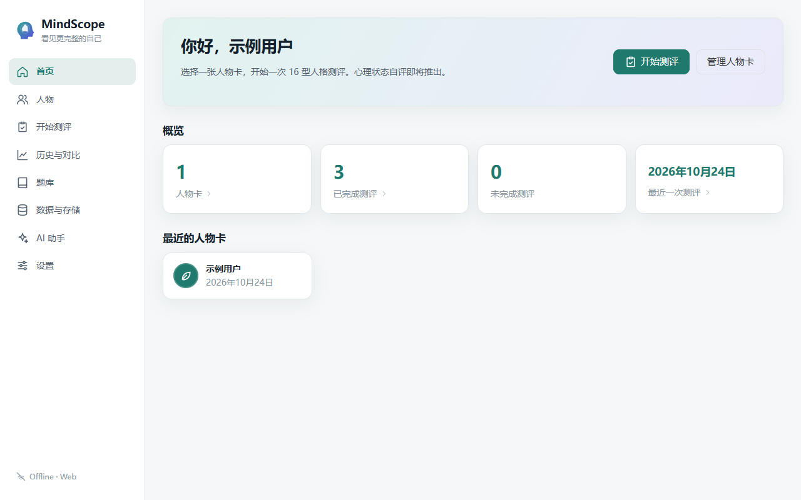
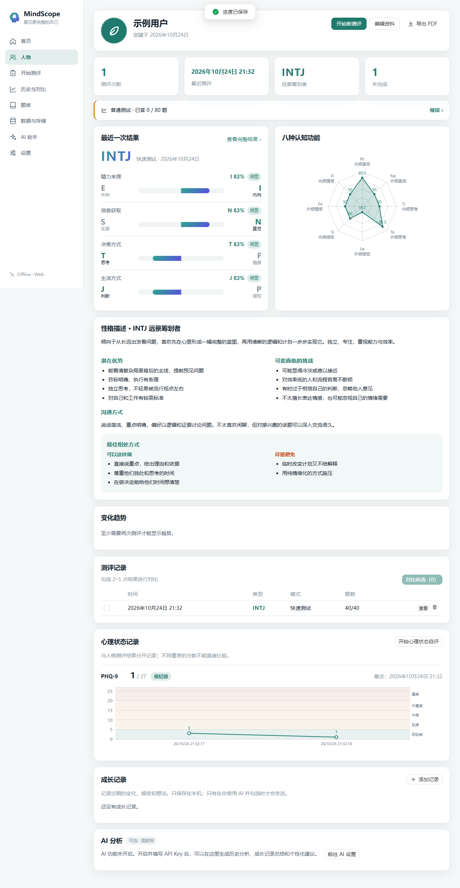
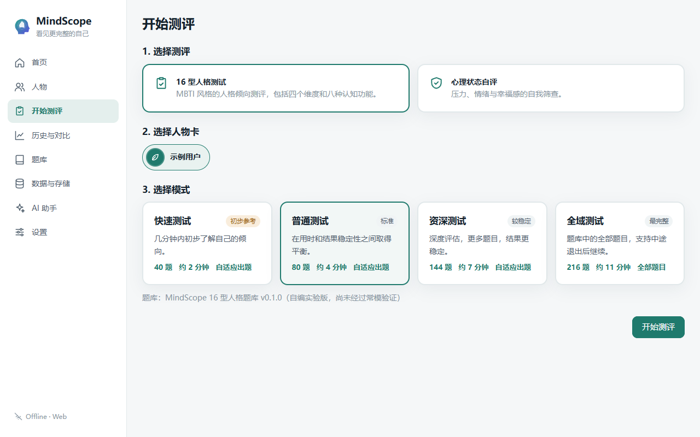
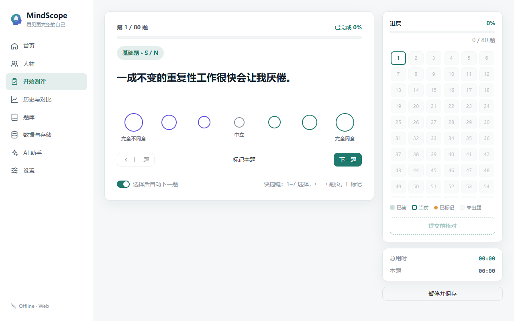
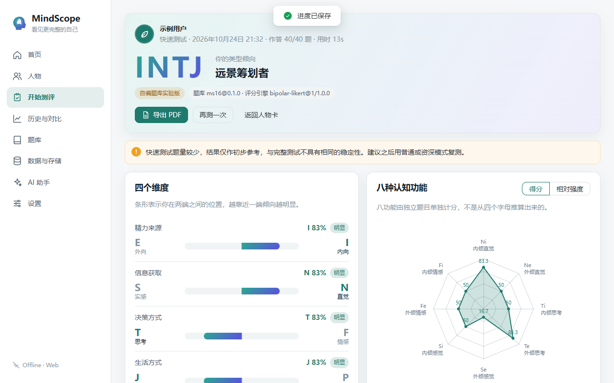
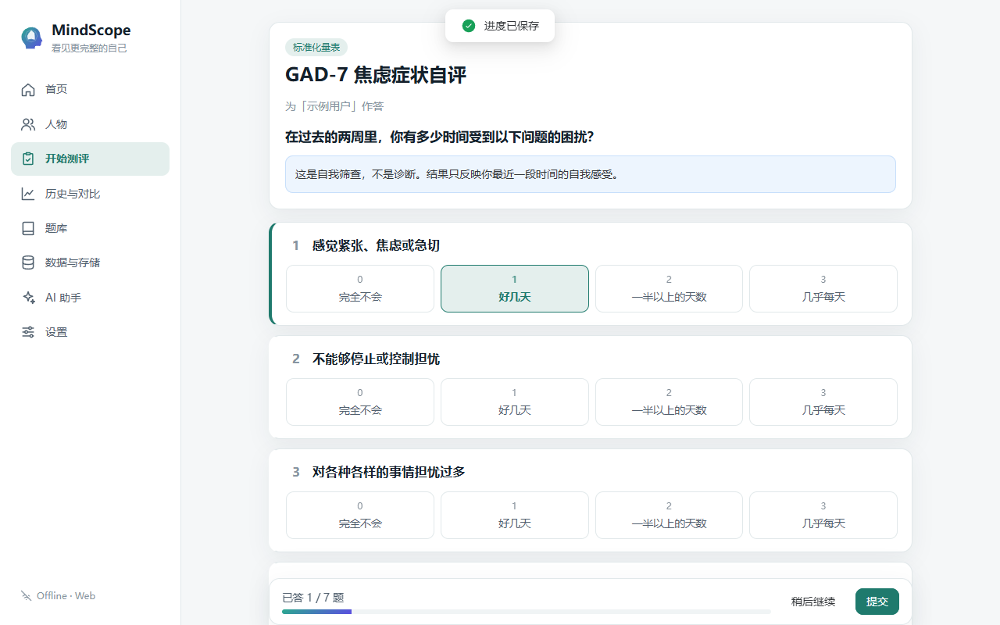
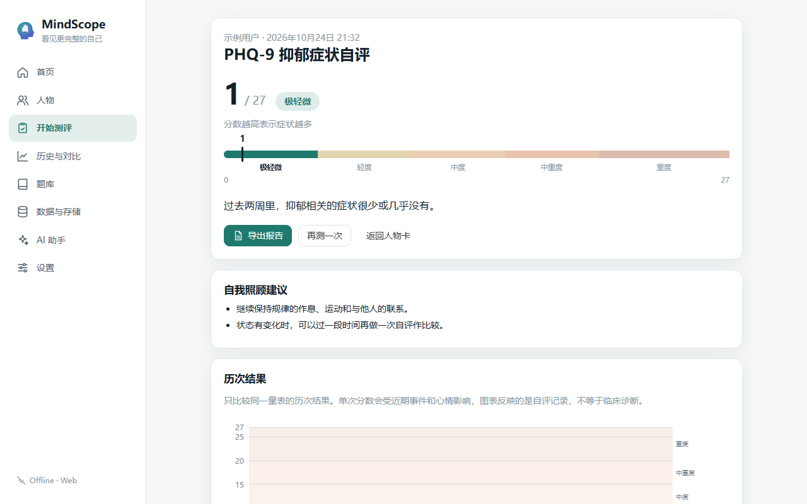
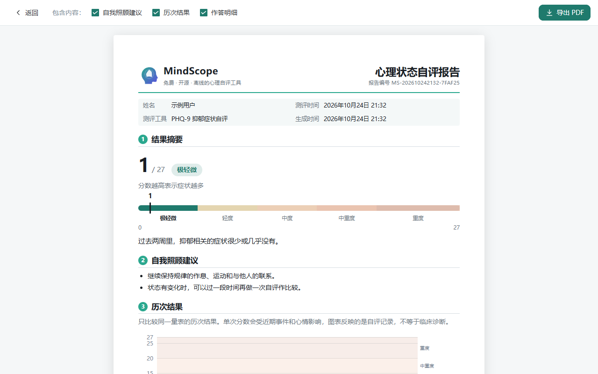
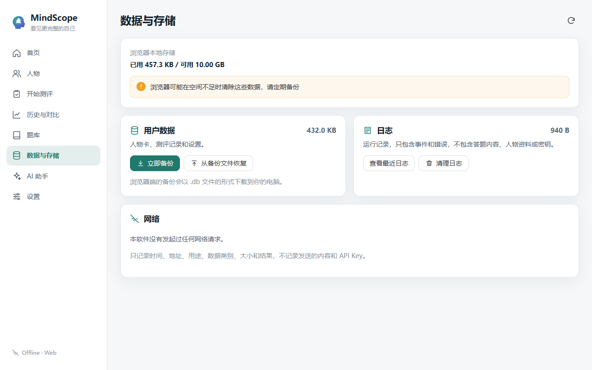

# MindScope 用户使用说明

> 适用版本：0.7.0 及以后。截图来自网页版，桌面版界面相同（个别数据管理功能只在桌面版提供，文中会注明）。

MindScope 是一个免费、开源、离线的自我了解工具，包括 16 型人格偏好测评和心理状态自评。**它不是诊断工具**：人格类型说明的是偏好，不是能力；心理状态自评只是自我筛查。

---

## 1. 安装与启动

### Windows 桌面版（推荐）

1. 下载 `MindScope-<版本>-win-x64-portable.zip`。
2. 解压到任意**可写**的文件夹，例如 `D:\MindScope`、`文档\MindScope` 或 U 盘。不建议放在 `C:\Program Files` 这类需要管理员权限的位置。
3. 双击 `MindScope.exe`。

- 不需要安装。所有数据都保存在 exe 旁边的 `data\`、`logs\`、`cache\`、`config\` 文件夹里，不会写入 C 盘的用户目录或注册表。
- **卸载**：关闭程序，删除整个文件夹即可（删除前记得备份，见第 10 节）。
- **换电脑 / 换位置**：把整个文件夹复制或移动过去即可，数据会跟着走。

**可能遇到的提示**

| 提示 | 原因与解决 |
|---|---|
| "没有找到 Microsoft Edge WebView2 运行时" | 界面需要这个微软组件。Windows 11 自带；Windows 10 可点"是"打开微软官方下载页安装（需要联网），装好后重新打开 MindScope |
| "MindScope 无法在以下位置保存数据" | 当前文件夹没有写入权限。把整个 MindScope 文件夹移到 `D:\` 或"文档"等位置后重新打开 |
| 再次双击时没有打开新窗口 | MindScope 同时只运行一个，会把已打开的窗口切到前面 |

### 网页版

在浏览器打开部署好的网址即可（部署方法见网页版包里的 `DEPLOY.txt`）。

- 数据保存在**你这台设备的这个浏览器**里，换浏览器或换设备看不到。
- 在浏览器里"清除网站数据"会删除 MindScope 的数据，请定期备份（见第 10 节）。
- 同一时间只能在一个标签页中使用。
- 网页版不提供 AI 功能。

## 2. 第一次使用

首次打开会播放约 3 秒的启动动画（点击可跳过，可在「设置 → 外观」关闭），然后请你为自己创建第一张**人物卡**，只需要填一个称呼。



首页显示：继续未完成的测评、概览（**四张卡片都可以点击**，分别跳到人物列表、历史记录、未完成的测评和最近一次结果）、最近的人物卡。

## 3. 人物卡

「人物」页可以为自己、家人、朋友分别建卡。

- **新建 / 编辑**：称呼必填；出生年份、性别、职业、备注、头像图片（只接受 PNG / JPG / WebP，会压缩后保存在数据库里）可选。
- **标签**：给人物卡分类（如"家人""同事"），列表可按标签筛选。
- **删除**：需要确认；该人物的所有测评、自评、成长记录和 AI 分析会一起删除。

点开一张人物卡可以看到：测评次数和最近一次时间、最近的人格类型、性格描述、沟通方式、**最佳相处方式**、四维与八功能的变化趋势、全部测评记录，以及心理状态记录、成长记录和 AI 分析。



带"示例数据"标记的人物卡是演示或测试生成的，和你的真实数据分开标注。

## 4. 16 型人格测评

「开始测评」→ 选择人物 → 选择"16 型人格"→ 选择模式：

| 模式 | 题量 | 适合 |
|---|---|---|
| 快速 | 40 | 初步了解；结果稳定性较低 |
| 普通 | 80 | 日常使用 |
| 资深 | 144 | 想要更准确的四维与八功能结果 |
| 全域 | 216（全部题目） | 完整作答 |



前三种模式是**自适应**的：程序会优先给最不确定的维度出题，所以每个人看到的题目不同；八种认知功能的题目会均匀穿插。

### 答题



- 7 个圆圈从"完全不同意"到"完全同意"，按自己的真实情况选择，不要选"应该怎样"。
- **快捷键**：数字 `1`–`7` 选择，`←` `→` 翻页，`F` 标记本题。
- 右侧进度矩阵显示已答、当前、已标记的题目，点击可跳转。
- "选择后自动下一题"可以关闭。
- **暂停并保存**：随时离开，下次从首页或测评页继续，已答的题目都在。
- 拿不准的题可以先点"下一题"跳过，或用 `F` 标记，之后在进度矩阵里点回去作答。
- 答完后进入"提交前核对"，会列出未作答和已标记的题目；还有未答题时，提交前会提示数量（未答的题不计分）。

### 看懂结果



- **类型代码**：四个字母，例如 INTJ。某个维度非常接近中间时显示 `X`，并列出可能的类型；作答太少无法判断时显示 `?`。
- **四个维度**：条形越靠近一端，倾向越明显（"明显 / 中等 / 轻微 / 接近均衡"）。
- **八种认知功能**：八边形雷达图。八功能由独立题目单独计分，不是从四个字母推算的；题目不足的功能不画出来。可切换"绝对分数 / 相对强度"。
- **类型理论中的功能顺序**：仅供参照，不是测量结果。
- **性格描述、最佳相处方式、成长建议**。
- **计算方法与局限**：每个维度的得分、标准误和有效题数都写在页面上，可以自己验算。

题库是 MindScope 自编的，还没有经过常模验证；这不是官方 MBTI。

## 5. 大五人格（先行版）

「开始测评」→ 选择人物 →「大五人格（先行版）」→ 选择模式：

| 模式 | 题目来源 | 题数 | 结果 |
|---|---|---|---|
| 快速 | Mini-IPIP | 20 | 五个维度（稳定性较低） |
| 普通 | IPIP 大五标记 50 题 | 50 | 五个维度 |
| 资深 | IPIP-NEO-120 | 120 | 五个维度 + 30 个子维度 |

- 五个维度：**开放性、尽责性、外向性、宜人性、情绪敏感性（神经质）**。"神经质"是心理学术语，指体验负面情绪的倾向，不是贬义，也不是疾病。
- 答题方式和 16 型测评相同（5 级选项，键盘 `1`–`5`），可以暂停续答；答题时不会提示这道题在测哪个维度。
- 结果显示每个维度 0–100 的分数和"偏低 / 中等 / 偏高"，以及五边形雷达图、每个维度的含义和"与 TA 相处"的提示；资深模式还有 30 个子维度。
- **先行版的含义**：题目来自心理学研究中广泛使用的国际人格题库 IPIP（公有领域），中文是 MindScope 翻译的，还没有经过验证；也没有中国人群常模，所以分数只表示你在量表上的位置，**不是"超过了多少人"**。
- 资深模式中"价值观开放"子维度的两道原题询问投票倾向，不适合中文语境，已换成中性题目。
- 大五人格和 16 型人格是两种不同的模型，分开记录，结果不能互相换算。人物卡、历史页和 PDF 报告里都有大五人格的记录。

## 6. 心理状态自评

「开始测评」→ 选择"心理状态自评"→ 选择量表：

| 量表 | 内容 | 题量 |
|---|---|---|
| PHQ-9 | 最近两周的抑郁相关症状 | 9 |
| GAD-7 | 最近两周的焦虑相关症状 | 7 |
| WHO-5 | 最近两周的主观幸福感（分数越高越好） | 5 |
| 压力自评 | MindScope 自编，**非标准化**，只作粗略参考 | 10 |



所有题目在一页上，答完全部才能提交，中途离开可以继续。



- 结果按官方分级显示；分数达到官方建议进一步评估的程度时，会提示"建议和专业人士聊一聊"。
- **PHQ-9 第 9 题**（伤害自己的念头）只要不是"完全不会"，无论总分多少，都会显示求助资源：全国统一心理援助热线 **12356**，紧急情况拨打 **110 / 120**。
- 只比较同一量表的历次结果；不同量表的分数不能相互比较。
- 页面下方有作答明细和量表的来源、许可说明。

心理状态记录和人格测评分开保存、分开统计；MindScope 不会用人格类型推断心理状态。

## 7. 历史与对比

「历史与对比」显示所有人的全部记录：

- 按人物、测评模式、日期范围筛选；
- 类型分布、每月测评次数、各人物测评次数图表；
- 勾选 2–5 次人格结果 →「对比」：可以是同一人的不同时间，也可以是不同的人。页面会提示是否可以直接比较（例如模式或题库版本不同），不同人之间会给出相处参考；
- 心理状态记录单独列出，可查看、删除；
- 删除单条记录需要确认（桌面版删除前会自动备份）。

## 8. 报告与 PDF

在结果页点「导出 PDF」、在自评结果页点「导出报告」，或在 AI 分析下点「打印 / 导出 PDF」，会打开正式报告页：



- 顶部可以勾选要包含的部分（例如作答明细附录）；求助信息和量表许可说明总是包含。
- 每页有页码和免责短句。
- **桌面版**：点「导出 PDF」选择保存位置（默认是 `data\exports`），完成后可以直接「打开文件」或「在文件夹中显示」。
- **网页版**：会打开浏览器的打印窗口，选择"另存为 PDF"。

## 9. 成长记录与 AI 分析（可选）

**成长记录**在人物卡里，按日期记下近期的变化、感受和想法。只保存在本机。

**AI 分析**默认关闭，只在桌面版提供：

1. 「AI 助手」→ 开启（会先说明数据去向，需要你同意）。
2. 选择服务商（阿里云百炼北京 / 新加坡，或其他 OpenAI 兼容接口），填写模型名称和你自己的 API Key，点「连接测试」。
3. 在人物卡的「AI 分析」里选择：人格历史分析、成长记录总结或个性化建议。
4. 发送前会显示：发到哪里、包含哪些数据（可以勾选）、以及**将发送的完整内容**。确认后才会发送。

- 姓名、备注、头像、逐题答案从不发送；心理状态分数、成长记录、年龄段和职业默认不发送。
- API Key 用 Windows 加密后保存在 `config` 文件夹，只有同一台电脑、同一 Windows 账户能读取；也可以选择"只在本次运行中使用"。换电脑后需要重新填写。
- AI 的回答标注"AI 生成 · 仅供参考"，下方列出由 MindScope 统计的依据。它可能出错，不是诊断。
- 每次请求都记录在「数据与存储 → 网络」中（不含内容和 Key）。

## 10. 数据与存储



| 功能 | 桌面版 | 网页版 |
|---|---|---|
| 查看数据、日志、缓存的位置和大小，并打开文件夹 | ✅ | 显示浏览器存储用量 |
| **立即备份** | 复制到 `data\backups`（升级、恢复、删除记录前也会自动备份） | 下载一个 `.db` 文件到你的电脑 |
| **恢复** | 从备份列表选择 | 选择之前下载的 `.db` 文件 |
| 迁移数据位置 | 选择新文件夹，数据会复制过去，重启后生效 | — |
| 查看 / 清理日志 | ✅ 日志只包含事件和错误，不包含答题内容、人物资料或密钥 | ✅ |
| 清理缓存 | ✅（界面缓存在下次启动时清理） | — |
| 网络记录 | ✅ | ✅ |

- 恢复前会先自动备份当前数据，恢复后程序会重新加载。
- 清理日志和缓存**不会**影响人物卡和测评记录。

**桌面版文件夹结构**

```
MindScope\
├── MindScope.exe
├── LICENSE.txt
├── data\        数据库、备份、导出的 PDF、头像（最重要，请备份）
├── logs\        运行日志（按天）
├── cache\       界面缓存，可随时清理
└── config\      启动设置；AI Key（加密）
```

## 11. 设置

- **外观**：主题（跟随系统 / 浅色 / 深色）、启动动画开关。
- **语言**：简体中文 / English。
- **关于**：版本、许可证、源代码地址（在浏览器中打开前会询问）。
- **诊断**：PDF 导出测试页，用于检查打印效果。

## 12. 常见问题

**结果和我以前在别处测的不一样？** 不同题库、不同题量的结果本来就会有差异；接近均衡的维度尤其容易变化。可以用普通或资深模式复测，并在人物卡中查看趋势。

**快速模式的结果可信吗？** 题量少，只适合初步了解，结果页会提示。

**家人能用同一个软件吗？** 可以，每人一张人物卡，数据互不混淆。

**怎么把数据带到另一台电脑？** 桌面版：复制整个文件夹（或用备份文件恢复）。网页版：下载备份 → 在另一台设备的网页版里恢复。

**心理状态分数很高怎么办？** 自评只是筛查，不是诊断。请联系医院精神心理科或心理咨询师进一步评估；需要倾诉时可拨打 12356；遇到紧急危险请拨打 110 或 120。
